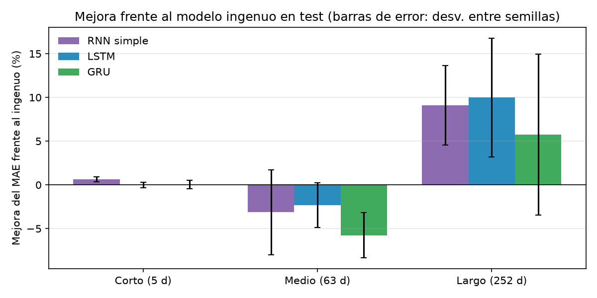
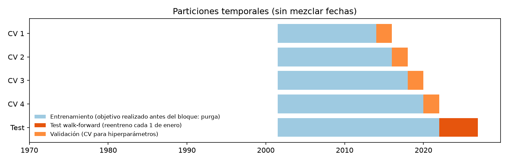

# Predicción del precio del petróleo (Brent) con RNN, LSTM y GRU

Caso de uso III de Aprendizaje Automático. Predicción del Brent a corto (5 días hábiles),
medio (63) y largo plazo (252) con RNN simple, LSTM y GRU, comparadas entre sí y con el modelo
ingenuo («el precio futuro = el precio de hoy»), e integración del modelo elegido en una
aplicación web HTML con Three.js que calcula la previsión, su rango de incertidumbre y la explica en
lenguaje sencillo.

Enunciado: [`docs/assignment/ENUNCIADO.pdf`](docs/assignment/ENUNCIADO.pdf) ·
Comparativa completa: [`reports/comparativa.md`](reports/comparativa.md)

## Resultados

Evaluación fuera de muestra con orígenes de previsión entre el 1-1-2022 y el último con precio
objetivo conocido (dato del Brent hasta el 3-11-2026), en $/barril, sobre los mismos orígenes para
todos los modelos. Ensemble de 5 semillas; intervalo del 80 % calibrado (conformal).

| Horizonte | Modelo | MAE ($) | RMSE ($) | R² | Mejora MAE vs ingenuo | Mejora RMSE vs ingenuo | p-valor DM | Acierto direccional | Cobertura IC80 | Anchura IC80 ($) | Winkler IC80 | Parámetros | Tiempo entren. (s) |
|---|---|---|---|---|---|---|---|---|---|---|---|---|---|
| Corto (5 d) | Ingenuo | 3.99 | 5.74 | 0.875 | — | — | — | — | 76.1 % | 10.61 | 19.93 | — | — |
| Corto (5 d) | RNN simple | 3.95 | 5.70 | 0.876 | +0.9 % | +0.6 % | 0.224 | 53.3 % | 79.0 % | 11.04 | 19.03 | 5959 | 0.9 |
| Corto (5 d) | LSTM | 3.99 | 5.74 | 0.875 | +0.0 % | +0.0 % | — | — | 75.9 % | 10.83 | 18.91 | 1339143 | 0.6 |
| Corto (5 d) | GRU | 3.98 | 5.73 | 0.875 | +0.1 % | +0.1 % | 0.372 | 50.7 % | 81.1 % | 11.98 | 19.12 | 1004807 | 0.4 |
| Medio (63 d) | Ingenuo | 11.94 | 17.44 | -0.207 | — | — | — | — | 84.5 % | 38.45 | 65.21 | — | — |
| Medio (63 d) | RNN simple | 11.47 | 17.12 | -0.163 | +4.0 % | +1.8 % | 0.118 | 59.2 % | 87.7 % | 49.66 | 75.72 | 22599 | 0.2 |
| Medio (63 d) | LSTM | 11.55 | 17.32 | -0.191 | +3.3 % | +0.7 % | 0.839 | 60.0 % | 85.7 % | 45.53 | 72.82 | 89031 | 0.2 |
| Medio (63 d) | GRU | 11.30 | 17.01 | -0.148 | +5.4 % | +2.4 % | 0.487 | 65.3 % | 88.2 % | 48.62 | 75.32 | 11751 | 3.2 |
| Largo (252 d) | Ingenuo | 16.50 | 22.53 | -1.466 | — | — | — | — | 93.3 % | 89.74 | 97.12 | — | — |
| Largo (252 d) | RNN simple | 17.63 | 27.06 | -2.559 | -6.8 % | -20.1 % | 0.120 | 54.3 % | 89.7 % | 113.94 | 128.91 | 204551 | 0.7 |
| Largo (252 d) | LSTM | 20.24 | 27.52 | -2.682 | -22.7 % | -22.2 % | 0.033 | 52.6 % | 88.7 % | 104.82 | 125.67 | 89031 | 0.1 |
| Largo (252 d) | GRU | 16.61 | 24.73 | -1.972 | -0.7 % | -9.8 % | 0.198 | 54.8 % | 95.3 % | 133.76 | 137.71 | 66887 | 0.1 |

Configuración adoptada tras dos rondas de experimentos (ver «Experimentos de mejora»): 80 trials
de búsqueda por red y horizonte, entrenamiento **sin deriva** y **recalibración del centro**
hacia el ingenuo según el acierto pasado.

**La app utiliza la RNN simple W1 en los tres horizontes**, con pesos específicos para 5, 63 y 252 sesiones. Para elegir una familia se dio el mismo peso a la mejora porcentual del MAE de cada horizonte frente al ingenuo. Con precios objetivo conocidos antes de 2022, la RNN W1 mejoró un **3,82 %** de media. La mejor familia W0 en ese periodo fue la LSTM (**0,28 %**). [Regla de selección](docs/experimento-ronda2.md)

En la comparación posterior de la app con las tres W0, la **GRU W0** obtuvo la mejor media conjunta desde 2022 (**+1,33 %** frente al ingenuo, frente al **−0,65 %** de la app). A 63 sesiones fue también la más precisa, con **11,099 USD/barril** de MAE frente a **11,469** de la app y **11,944** del ingenuo. A 5 sesiones ganó la app y a 252 ganó la LSTM W0 entre estas opciones. El periodo desde 2022 ya se había examinado y se utiliza para describir el comportamiento posterior de la familia elegida. [Comparación anual de W0 y la app](reports/results/experiments/w0_familias/resultado.md)

En el test, la RNN W1 redujo el MAE frente al ingenuo un **0,89 %** a 5 sesiones y un **3,98 %** a 63. A 252 sesiones su MAE fue **un 6,82 % mayor**. El informe recoge los errores por año, el acierto direccional, los intervalos y los contrastes estadísticos. [Comparativa de la app](reports/comparativa.md) · [Registro de experimentos](docs/registro-experimentos.md)



## Puesta en marcha

Requisitos: Python ≥ 3.12 y [Poetry](https://python-poetry.org) 2.x.

```bash
poetry install                                  # dependencias + paquete oilcast (src/)
poetry run python -m oilcast serve   # la app funciona ya con los datos y el modelo del repo
```

Abre **http://127.0.0.1:8501**. El comando admite `--port` para elegir otro puerto.

La aplicación usa el modelo entrenado incluido en `models/` y el último dataset guardado en
`data/`, así que funciona sin conexión. Desde **Datos y modelo** se pueden **descargar los datos
más recientes** y **reentrenar** el modelo (modo rápido de 1 semilla: unos minutos en CPU).

> Nota: si la ruta del proyecto contiene espacios, el lanzador `poetry run oilcast` no funciona
> (limitación de los *shebang*); usa siempre `poetry run python -m oilcast ...` (o el `Makefile`).

### Pipeline paso a paso

| Paso | Comando | Salida |
|---|---|---|
| Descarga de datos en bruto | `make download` | `data/raw/*.csv` (sin rellenar) |
| Dataset sobre el calendario del Brent | `make build` | `data/processed/brent_dataset.csv` |
| Búsqueda de hiperparámetros (CV purgada) | `make tune` | `reports/results/tuning/` |
| Evaluación walk-forward en test | `make evaluate` | `reports/results/predictions/` |
| Tiempos de entrenamiento comparables | `make timing` | `reports/results/timing.csv` |
| Métricas, tabla y elección del modelo | `make summarize` | `reports/results/comparison.csv`, `selection.json` |
| Modelo de producción | `make train-final` | `models/` |
| Informe y figuras | `make report` | `reports/comparativa.md`, `reports/figures/` |
| Previsión en terminal | `make forecast` | — |
| Reentrenado periódico (hiperparámetros guardados) | `make retrain` | `models/` |

Todos los comandos aceptan otra configuración (`CONFIG=configs/smoke.yaml`). `make smoke`
ejecuta el pipeline completo con una configuración mínima en CPU en ~3 minutos (escribe en
directorios `*_smoke`, ignorados por git). `make test` y `make lint` lanzan pytest y ruff.

El script original del enunciado, `scripts/download_data.py`, se conserva sin cambios como
referencia (genera `data/petroleo_dataset.csv`); el pipeline usa su propia descarga por los
motivos explicados en [Datos](#datos-y-limpieza).

## Estructura

```text
configs/            default.yaml (todos los parámetros) · smoke.yaml (prueba rápida)
src/oilcast/
  data/             download.py (FRED, Yahoo, OPEP) · dataset.py (calendario del Brent, limpieza)
  features/         engineering.py (variables estacionarias) · windows.py (ventanas, objetivo, escalado)
  models/           recurrent.py (RNN/LSTM/GRU con cabeza de cuantiles) · naive.py
  training/         splits.py (walk-forward purgado) · trainer.py · tune.py (Optuna)
                    evaluate.py (test walk-forward) · benchmark.py (tiempos) · final.py (producción)
  evaluation/       metrics.py · conformal.py · summary.py (tablas, elección) · report.py
  inference/        forecaster.py · calendar.py (días hábiles del Brent)
  explain/          narrative.py (texto para no técnicos) · events.py (ciclo económico)
  cli.py            python -m oilcast {download|build|tune|evaluate|timing|summarize|train-final|forecast|report|all}
app/                static/ (HTML, CSS, gráficos, Three.js) · vendor.mjs
notebooks/          01_eda_y_limpieza.ipynb · 02_comparativa_modelos.ipynb
data/               raw/ (series originales) · processed/ (dataset de modelado) · petroleo_dataset.csv (script original)
models/             modelo de producción (pesos, escalador, metadatos)
reports/            comparativa.md · figures/ · results/ (predicciones, métricas, estudios Optuna)
scripts/            download_data.py (original) · experimentos y reproducción
tests/              splits, ventanas, escalado, look-ahead, métricas, end-to-end, app
```

## Metodología

### Datos y limpieza

- **Fuentes**: FRED (Brent y WTI spot de la EIA, gas Henry Hub, tipo de depósito del BCE,
  USD/EUR, CNY/USD, VIX) y Yahoo Finance (futuros WTI y Brent con OHLCV, cobre, oro, índice
  dólar), diarios desde 2000. La **cesta OPEP no se ha podido descargar**: la web de la OPEP
  responde 403 a clientes automáticos; el pipeline la trata como opcional.
- **Calendario real del Brent**: el CSV generado por el script original rellena hacia delante
  también el Brent, de modo que 577 filas repiten el precio anterior (festivos y los últimos días,
  porque la EIA publica con retraso). Entrenar con esas filas inventa días de «precio sin cambio».
  Aquí el dataset solo contiene días con precio real del Brent; las demás series se alinean con el
  último valor disponible en cada fecha (nunca hacia atrás).
- **Outliers**: el WTI a −36,98 $ (20-4-2020), los futuros ≤ 0 y los días con volumen 0 se tratan
  como dato no válido en las entradas. Los extremos reales del Brent (143,95 $ en 2008, 9,12 $ en
  2020, 133,18 $ en 2022, 138,21 $ en 2026) **se conservan**: se modelan rentabilidades, las
  entradas se recortan a percentiles del entrenamiento y la pérdida de cuantiles es robusta.
- **Variables** (20, todas estacionarias y calculadas solo con información pasada):
  rentabilidades diarias de Brent, WTI, gas, oro, cobre, índice dólar, USD/EUR y CNY/USD; log
  VIX; tipo del BCE y su variación; diferencial Brent-WTI; base y rango del futuro WTI; volumen
  relativo; volatilidad realizada (21 y 63 días); desviación del Brent respecto a sus medias de
  63 y 252 días y momentum de 252 días. Los futuros del Brent (desde 2007) no se usan.
  Detalle en `notebooks/01_eda_y_limpieza.ipynb`.

### Modelo

- **Objetivo** para cada horizonte h ∈ {5, 63, 252}: rentabilidad logarítmica
  log(P[t+h]/P[t]) contada en días de cotización del Brent. Un modelo por arquitectura y
  horizonte (predicción directa). Previsión de precio = P[t]·exp(mediana).
- **Redes**: una sola clase con celda intercambiable (RNN simple, LSTM o GRU), misma ventana de
  60 días, mismas variables y misma cabeza lineal que produce 7 cuantiles (5 %…95 %) entrenada
  con pérdida *pinball*. Valor central = mediana; intervalo del 80 % = cuantiles 10-90.
- **Sin deriva**: la red aprende desviaciones respecto a la rentabilidad media del
  entrenamiento y esa media no se le devuelve, para que no proyecte al futuro la subida de
  2001-2013.
- **Recalibración del centro**: la mediana se multiplica por un factor entre 0 y 1 estimado solo
  con los errores ya conocidos en cada fecha (0 = ingenuo mientras no haya al menos 100). Encoge
  las apuestas de la red cuando su acierto pasado no las justifica; también se aplica en la app.
- **Calibración conformal** (CQR): el intervalo se ensancha o estrecha según los errores fuera de
  muestra ya realizados *antes* de cada previsión, para que cubra ≈ 80 % de los casos.
- **Modelo ingenuo**: precio futuro = precio actual; su intervalo usa los cuantiles empíricos de
  las variaciones a h días del periodo de entrenamiento.

### Validación sin fugas de información



- **Test**: orígenes desde el 1-1-2022 hasta el último cuyo precio objetivo ya se conoce.
- **CV de hiperparámetros** (solo con datos anteriores a 2022): walk-forward expansiva con 4
  bloques de validación de 2 años (2014-15, 2016-17, 2018-19, 2020-21). **Purga**: una muestra
  solo puede entrenar si su precio objetivo (t + h) es anterior al inicio del bloque que no debe
  ver; y ninguna validación usa precios de 2022 en adelante.
- **Optuna** (TPE + poda por mediana), **80 trials** por red y horizonte, mismo espacio (tamaño
  oculto 16-256, 1-3 capas, dropout, tasa de aprendizaje, weight decay, batch) y misma semilla
  para las tres redes. Objetivo: pérdida pinball media en validación. *Early stopping* dentro de cada bloque.
- **Evaluación en test**: reentreno cada 1 de enero (2022…2026) con todos los datos cuyo objetivo
  ya se conocía, hiperparámetros y nº de épocas fijados en la CV (el test nunca decide cuándo
  parar), **5 semillas**: se informa el ensemble y la dispersión entre semillas.
- **Escalado**: recorte y estandarización ajustados solo con el tramo de entrenamiento de cada
  partición/reentreno.
- **Métricas** en $/barril sobre los mismos orígenes para todos los modelos: MSE, MAE, RMSE, R²,
  acierto direccional, mejora frente al ingenuo, test de Diebold-Mariano (varianza HAC con h−1
  retardos, porque los objetivos a h días se solapan), cobertura y anchura del intervalo, y
  desglose por año.
- **Tests automáticos** (`tests/`): purga y no solapamiento de particiones, alineación de
  ventanas y objetivo, escalador ajustado solo con train, ausencia de *look-ahead* (cambiar el
  futuro no cambia las variables ni la previsión de un origen), métricas, conformal, modelo
  ingenuo, pipeline end-to-end en miniatura y la API HTTP de la app.

## Aplicación

`poetry run python -m oilcast serve`

- **Previsión**: selector de horizonte (corto, medio, largo); último precio y su fecha, precio
  previsto, variación esperada en $ y %, intervalo del 80 %; gráfico del histórico con medias
  móviles y abanico de previsión a los tres horizontes (fechas en días hábiles del Brent).
- **Explicación** generada con reglas (sin servicios externos) a partir de las métricas guardadas:
  qué significa la previsión, qué fiabilidad tuvo ese horizonte en test frente al ingenuo y qué
  factores pueden invalidarla.
- **Ciclo económico**: histórico con los principales picos y caídas (2008, crisis financiera,
  2014-2016, pandemia, Ucrania 2022, guerra con Irán en 2026 y movimientos posteriores) y su
  explicación; además se marcan giros detectados automáticamente por su magnitud.
- **Validación** muestra el R² junto a MAE, MSE, RMSE y las demás métricas de test. Permite elegir una red y cotejar las predicciones con el Brent real en la fecha objetivo.
- **Redes 3D** representa tres pasos temporales de la RNN simple, la LSTM y la GRU. La escena se puede girar, acercar y pausar. La ficha muestra la configuración entrenada de cada horizonte.
- **Datos y modelo** permite descargar nuevas observaciones y generar previsiones con los pesos guardados. El reentrenamiento es una acción independiente con una o cinco semillas.
- La cabecera utiliza una ilustración generada de una plataforma del mar del Norte al anochecer, con mar oscuro, bruma y luces de trabajo ámbar.
- Los módulos de Three.js, Chart.js y las fuentes se sirven localmente. Para reconstruir estas dependencias de navegador se puede ejecutar `npm ci --prefix app` y `npm --prefix app run vendor`.

<details>
<summary>Crédito de la imagen de cabecera</summary>

Ilustración creada con el generador de imágenes integrado y guardada en [app/static/plataforma.webp](app/static/plataforma.webp). Instrucción utilizada:

> Photorealistic panoramic editorial photograph for the header of a premium Spanish Brent oil research instrument. An immense North Sea offshore oil production platform in three-quarter view, steel lattice tower, twin cranes, piping decks, tiny warm amber working lamps, realistic sea legs. Platform on the right half, entire tower and waterline visible with breathing room above and below, photographed from another vessel in overcast teal dusk, layers of fog, glassy dark choppy ocean, subtle teal sea haze, rich ink-blue black shadows. The left half is empty open water and quiet foggy sky with no objects, so a dark gradient can blend text there. Brightest detailed steel and lamps on right center. Elegant analog grain, restrained silver and sea-green color grade, industrial magazine shot, cinematic wide framing, 3:1 horizontal banner composition. No writing, graphic overlays, logos, watermark or letters.

</details>

## Experimentos de mejora

Las dos primeras rondas determinaron la RNN que utiliza la aplicación. Después se compararon
ventanas diarias de distinta duración, señales adelantadas y dos arquitecturas económicas.
El historial reúne los protocolos, los resultados y la decisión de cada prueba.
[Registro de experimentos del Brent](docs/registro-experimentos.md)

- **Ronda 1** ([docs/experimento-ampliado.md](docs/experimento-ampliado.md)): búsqueda de
  hiperparámetros más amplia y variables diarias de geopolítica, incertidumbre y macroeconomía.
  Solo aporta la búsqueda ampliada; las variables nuevas no mejoran.
- **Ronda 2** ([docs/experimento-ronda2.md](docs/experimento-ronda2.md)): entrenar sin la
  deriva alcista aprendida en 2001-2013 y encoger la predicción según su acierto pasado. Con la
  RNN simple gana al ingenuo a 1 semana (+0,9 %) y a 3 meses (+4,0 %) y sigue perdiendo a
  12 meses (−6,8 %); ninguna diferencia es estadísticamente significativa.
- **Modelo económico a doce meses.** En las mismas 971 fechas de test, la LSTM económica
  obtuvo un MAE de 15,45 USD/barril frente a 16,50 del ingenuo. El ingenuo obtuvo menor
  RMSE (22,53 frente a 23,51). La LSTM se conserva como candidata anual.
  [Comparativa de las tres redes económicas](reports/results/experiments/economic_v2/resultado.md)

## Limitaciones

- El periodo de test (2022-2026) contiene dos shocks geopolíticos extremos (Ucrania 2022 y la
  guerra con Irán en 2026). Ningún modelo basado solo en precios pasados puede anticiparlos;
  las métricas dependen mucho de esos episodios (ver el desglose por año).
- A 252 días el test cubre solo unos 4 años de orígenes cuyos objetivos se solapan casi por
  completo: el número efectivo de observaciones independientes es muy pequeño y los p-valores
  son orientativos.
- El test 2022-2026 se consultó durante los experimentos de mejora. Las decisiones se tomaron con
  datos anteriores a 2022 y con reglas escritas antes de ejecutar, pero el test ya no es una
  evaluación completamente ciega: las cifras de la configuración adoptada pueden ser algo
  optimistas.
- El Brent spot de la EIA se publica con unos días de retraso; la previsión parte del último
  dato oficial.
- Las fechas objetivo usan un calendario aproximado (festivos del Reino Unido).
- La cesta OPEP no está disponible por bloqueo de la web oficial.
- No es asesoramiento financiero: es una herramienta estadística de apoyo.

## Estado

- [x] Descarga de datos
- [x] EDA y limpieza (huecos, outliers, WTI negativo)
- [x] Escalado (solo con train) y ventanas de 60 días
- [x] RNN / LSTM / GRU con validación walk-forward + baseline ingenuo
- [x] Tabla comparativa (R², MAE, RMSE, mejora vs ingenuo, parámetros, tiempo)
- [x] App HTML y Three.js (3 horizontes, intervalo 80 %, explicación, ciclo económico, reentrenado)
- [ ] Presentación de máximo 5 diapositivas
