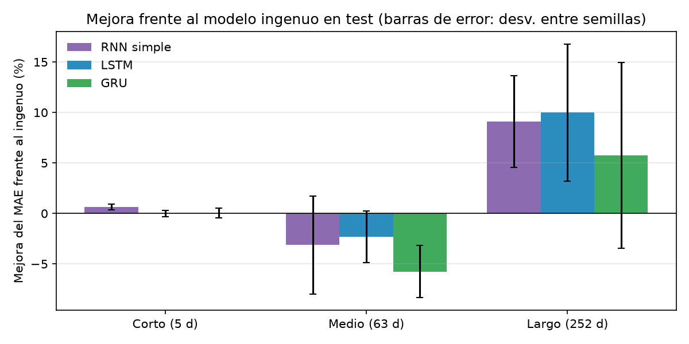
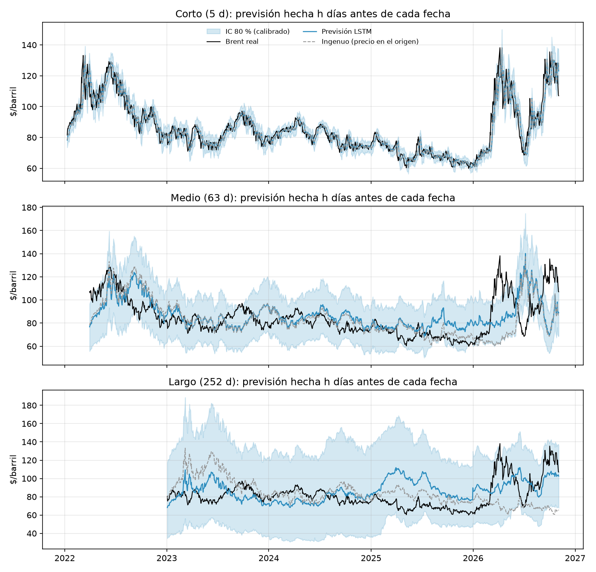

# Comparativa RNN simple vs LSTM vs GRU (y modelo ingenuo)

> Documento generado automáticamente por `oilcast report` a partir de `reports/results/`.
> Todas las cifras son **fuera de muestra** sobre el periodo de test (orígenes desde
> 2022-01-01) y se calculan en **dólares por barril**, sobre exactamente los mismos
> orígenes para las tres redes y para el modelo ingenuo.

## Condiciones de la comparación

- **Mismos datos y misma ventana**: las tres redes reciben las mismas
  60 sesiones de entrada en cada plazo.
  A 5 sesiones, 20 variables estacionarias (rentabilidades, diferenciales, volatilidad, desviaciones a medias móviles).
  A 63 y 252 sesiones, solo `oro_crudo`: barriles por onza de oro (log) frente a su media de 3 años, con un atajo lineal desde el último día (docs/experimento-ronda4.md).
- **Misma partición**: CV walk-forward expansiva y purgada en desarrollo (4 bloques de
  validación de 2 años: 2014-15, 2016-17, 2018-19, 2020-21) y test walk-forward desde
  2022-01-01 con reentreno cada 1 de enero, con los hiperparámetros y el nº de épocas
  fijados en la CV (el test nunca se usa para parar el entrenamiento).
- **Mismo presupuesto de ajuste**: 80 trials de Optuna (TPE, misma
  semilla, mismo espacio de búsqueda) por red y horizonte.
- **Salida probabilística**: cuantiles (pérdida pinball); valor central = mediana;
  intervalo del 80 % = cuantiles 10-90 calibrados con conformal (CQR) usando solo errores
  ya realizados antes de cada previsión.
- **5 semillas** por red: se informa el ensemble (media de
  las semillas) y la dispersión entre semillas (estabilidad).
- Modelo ingenuo: precio futuro = precio de hoy; su intervalo usa los cuantiles empíricos de
  las variaciones a h días del periodo de entrenamiento.
- **Sin deriva**: las redes aprenden desviaciones respecto a la media del entrenamiento y no se les devuelve esa media, para que no proyecten al futuro la tendencia del periodo de entrenamiento.
- **Recalibración del centro**: el valor central se encoge hacia el del ingenuo con un factor entre 0 y 1 estimado solo con los errores ya conocidos en cada fecha.

## Tabla comparativa (test)

| Horizonte | Modelo | MAE ($) | RMSE ($) | R² | Mejora MAE vs ingenuo | Mejora RMSE vs ingenuo | p-valor DM | Acierto direccional | Cobertura IC80 | Anchura IC80 ($) | Winkler IC80 | Parámetros | Tiempo entren. (s) |
|---|---|---|---|---|---|---|---|---|---|---|---|---|---|
| Corto (5 d) | Ingenuo | 3.99 | 5.74 | 0.875 | — | — | — | — | 76.1 % | 10.61 | 19.93 | — | — |
| Corto (5 d) | RNN simple | 3.96 | 5.71 | 0.876 | +0.6 % | +0.5 % | 0.148 | 53.3 % | 78.1 % | 10.80 | 19.09 | 5959 | 0.8 |
| Corto (5 d) | LSTM | 3.99 | 5.74 | 0.875 | +0.0 % | +0.0 % | — | — | 74.7 % | 10.54 | 19.00 | 1339143 | 0.6 |
| Corto (5 d) | GRU | 3.99 | 5.74 | 0.875 | +0.0 % | +0.0 % | 0.445 | 50.7 % | 78.8 % | 11.41 | 19.16 | 1004807 | 0.4 |
| Medio (63 d) | Ingenuo | 11.94 | 17.44 | -0.207 | — | — | — | — | 84.1 % | 37.60 | 65.11 | — | — |
| Medio (63 d) | RNN simple | 12.32 | 16.90 | -0.133 | -3.1 % | +3.1 % | 0.509 | 56.6 % | 86.3 % | 44.47 | 63.31 | 331285 | 2.1 |
| Medio (63 d) | LSTM | 12.22 | 16.29 | -0.053 | -2.3 % | +6.6 % | 0.456 | 52.5 % | 87.4 % | 43.13 | 58.37 | 332181 | 1.5 |
| Medio (63 d) | GRU | 12.63 | 16.87 | -0.130 | -5.8 % | +3.2 % | 0.520 | 53.9 % | 86.4 % | 41.87 | 59.84 | 16277 | 0.2 |
| Largo (252 d) | Ingenuo | 16.50 | 22.53 | -1.466 | — | — | — | — | 93.4 % | 90.15 | 97.57 | — | — |
| Largo (252 d) | RNN simple | 15.00 | 17.84 | -0.548 | +9.1 % | +20.8 % | 0.413 | 57.0 % | 99.6 % | 88.38 | 88.55 | 68117 | 0.3 |
| Largo (252 d) | LSTM | 14.85 | 17.86 | -0.550 | +10.0 % | +20.7 % | 0.396 | 53.6 % | 99.6 % | 89.95 | 90.17 | 84181 | 1.1 |
| Largo (252 d) | GRU | 15.55 | 19.29 | -0.809 | +5.7 % | +14.4 % | 0.526 | 61.1 % | 98.9 % | 90.49 | 91.38 | 990229 | 1.1 |

El R² compara el error cuadrático con el que se obtiene usando la media de los precios reales
del tramo evaluado. Puede ser negativo. El modelo ingenuo usa el último precio conocido.

*Mejora* = reducción porcentual del error frente al ingenuo (positivo = mejor que el
ingenuo). *p-valor DM*: test de Diebold-Mariano (error cuadrático, varianza HAC con h-1
retardos); valores < 0,05 indican diferencia significativa. Con h = 252 el test solo cubre
unos pocos años no solapados, por lo que su p-valor es orientativo. Tiempo de entrenamiento:
un ajuste completo (épocas fijas) sobre todo el periodo de desarrollo, medido en secuencia
en GPU.

## Estabilidad entre semillas

| Horizonte | Modelo | MAE ensemble | MAE por semilla (media ± desv.) | Mejora MAE por semilla (desv.) | Cobertura IC80 sin calibrar | MSE |
|---|---|---|---|---|---|---|
| Corto (5 d) | RNN simple | 3.96 | 3.94 ± 0.01 | 0.3 % | 73.4 % | 32.6 |
| Corto (5 d) | LSTM | 3.99 | 3.99 ± 0.01 | 0.3 % | 73.8 % | 32.9 |
| Corto (5 d) | GRU | 3.99 | 3.99 ± 0.02 | 0.5 % | 77.2 % | 32.9 |
| Medio (63 d) | RNN simple | 12.32 | 12.92 ± 0.58 | 4.8 % | 81.6 % | 285.5 |
| Medio (63 d) | LSTM | 12.22 | 12.26 ± 0.30 | 2.6 % | 80.3 % | 265.4 |
| Medio (63 d) | GRU | 12.63 | 13.02 ± 0.31 | 2.6 % | 81.7 % | 284.7 |
| Largo (252 d) | RNN simple | 15.00 | 15.19 ± 0.75 | 4.5 % | 98.0 % | 318.4 |
| Largo (252 d) | LSTM | 14.85 | 15.19 ± 1.12 | 6.8 % | 96.6 % | 319.0 |
| Largo (252 d) | GRU | 15.55 | 15.92 ± 1.52 | 9.2 % | 94.0 % | 372.3 |

## Resultados por año (mejora del MAE frente al ingenuo)

| Horizonte | Modelo | 2022 | 2023 | 2024 | 2025 | 2026 |
|---|---|---|---|---|---|---|
| Corto (5 d) | RNN simple | +1.0 % | +0.4 % | +1.5 % | +0.7 % | +0.0 % |
| Corto (5 d) | LSTM | +0.0 % | +0.0 % | +0.0 % | +0.0 % | +0.0 % |
| Corto (5 d) | GRU | +0.1 % | -0.0 % | +0.1 % | -0.0 % | +0.0 % |
| Corto (5 d) | MAE ingenuo ($) | 5.35 | 3.00 | 2.36 | 2.39 | 7.45 |
| Medio (63 d) | RNN simple | +12.0 % | +10.5 % | -65.1 % | -21.0 % | +4.6 % |
| Medio (63 d) | LSTM | +9.1 % | +4.1 % | -23.7 % | -41.9 % | +11.1 % |
| Medio (63 d) | GRU | +8.7 % | +6.9 % | -58.0 % | -33.9 % | +5.2 % |
| Medio (63 d) | MAE ingenuo ($) | 12.94 | 8.62 | 4.82 | 9.07 | 32.75 |
| Largo (252 d) | RNN simple | +45.1 % | -10.5 % | -122.2 % | +47.4 % | — |
| Largo (252 d) | LSTM | +42.4 % | -19.7 % | -96.9 % | +42.9 % | — |
| Largo (252 d) | GRU | +38.1 % | -31.4 % | -95.9 % | +38.6 % | — |
| Largo (252 d) | MAE ingenuo ($) | 19.32 | 7.61 | 11.43 | 29.64 | — |

## Hiperparámetros elegidos en la CV

| Modelo | Horizonte | hidden | capas | dropout | lr | weight decay | batch | épocas (fijas) | trials (podados) |
|---|---|---|---|---|---|---|---|---|---|
| RNN simple | 5 | 64 | 1 | 0.50 | 6.2e-04 | 1.1e-05 | 128 | 25 | 80 (31) |
| RNN simple | 63 | 256 | 3 | 0.43 | 1.6e-03 | 2.6e-03 | 64 | 16 | 80 (34) |
| RNN simple | 252 | 256 | 1 | 0.38 | 1.7e-03 | 5.4e-04 | 128 | 9 | 80 (43) |
| LSTM | 5 | 256 | 3 | 0.09 | 8.9e-04 | 5.3e-04 | 128 | 3 | 80 (40) |
| LSTM | 63 | 128 | 3 | 0.48 | 1.1e-03 | 1.1e-05 | 256 | 14 | 80 (24) |
| LSTM | 252 | 64 | 3 | 0.11 | 2.6e-03 | 3.3e-03 | 128 | 22 | 80 (48) |
| GRU | 5 | 256 | 3 | 0.47 | 2.9e-03 | 9.7e-03 | 128 | 2 | 80 (35) |
| GRU | 63 | 32 | 3 | 0.35 | 3.0e-03 | 1.5e-06 | 256 | 6 | 80 (6) |
| GRU | 252 | 256 | 3 | 0.25 | 1.9e-03 | 7.6e-03 | 64 | 4 | 80 (47) |

## Elección del modelo para la aplicación

Regla aplicada: regla fijada antes de la búsqueda de la ronda 4 (docs/experimento-ronda4.md): se elige la combinación de variante y red con mayor mejora media del MAE frente al ingenuo en los tres plazos, en orígenes de 2008 a 2021 con objetivo anterior a 2022, sin mirar el test. Ganó la LSTM con la relación oro/crudo a 63 y 252 sesiones (+5,3 % antes de 2022, +5,6 % en 2008-2013, años que no se usaron para elegir hiperparámetros).

| Modelo | MAE relativo medio (modelo/ingenuo) | Desv. relativa entre semillas | Parámetros (media) | Cobertura IC80 media |
|---|---|---|---|---|
| LSTM | 0.974 | 3.5 % | 585168 | 87.2 % |
| RNN simple | 0.978 | 3.3 % | 135120 | 88.0 % |
| GRU | 1.000 | 4.2 % | 670438 | 88.0 % |

Tiempo total de entrenamiento de los tres horizontes: RNN simple 3 s, LSTM 3 s, GRU 2 s

**Modelo elegido: LSTM.**

## Conclusión

**Modelo para la aplicación: LSTM.**

- **Precisión**: su MAE medio es 0,974 veces el del ingenuo, el mejor de las tres redes; RNN simple 0,978, GRU 1,000.
- **Estabilidad**: desviación relativa del MAE entre semillas 3,5 %.
- **Coste computacional**: entrenar los tres horizontes cuesta 3,2 s en GPU (RNN simple 3,3 s, GRU 1,7 s); el coste no discrimina entre redes y el reentrenado periódico es viable en CPU.

**Dónde aporta valor y dónde no**

- **Corto (5 d)**: **coincide con el ingenuo**: la recalibración del centro no ha encontrado errores pasados que justifiquen mover la previsión (las tres redes entre +0,0 % y +0,6 %). No mueve el valor central, así que no hay acierto direccional que medir. El intervalo del 80 % calibrado cubre el 74,7 % de los casos (ingenuo: 76,1 %) y su puntuación de Winkler (anchura + penalización por fallos; menor es mejor) es 19,00 frente a 19,93 del ingenuo: el rango es algo más informativo que el del ingenuo.
- **Medio (63 d)**: **no aporta valor en el valor central en MAE**: el error absoluto es mayor que el del ingenuo (-2,3 % de MAE, +6,6 % de RMSE, p-valor DM 0,456; las tres redes entre -5,8 % y -2,3 % de MAE); solo mejora en 3 de 5 años. Acierta la dirección en el 52,5 % de los casos (apostar siempre por el movimiento más frecuente del periodo, algo que no se sabe de antemano, habría acertado el 56,8 %). El intervalo del 80 % calibrado cubre el 87,4 % de los casos (ingenuo: 84,1 %) y su puntuación de Winkler (anchura + penalización por fallos; menor es mejor) es 58,37 frente a 65,11 del ingenuo: el rango es algo más informativo que el del ingenuo.
- **Largo (252 d)**: mejora del valor central (+10,0 % de MAE y +20,7 % de RMSE; las tres redes entre +5,7 % y +10,0 % de MAE), positiva en 2 de 4 años, **no significativa** (p-valor DM 0,396). Acierta la dirección en el 53,6 % de los casos (apostar siempre por el movimiento más frecuente del periodo, algo que no se sabe de antemano, habría acertado el 67,7 %). El intervalo del 80 % calibrado cubre el 99,6 % de los casos (ingenuo: 93,4 %) y su puntuación de Winkler (anchura + penalización por fallos; menor es mejor) es 90,17 frente a 97,57 del ingenuo: el rango es algo más informativo que el del ingenuo.

**Interpretación.** A partir solo de precios y variables de mercado pasadas, el precio del crudo se comporta casi como un paseo aleatorio, y el periodo de test incluye dos shocks geopolíticos (Ucrania 2022 y la guerra con Irán en 2026) que ningún modelo de este tipo puede anticipar. El modelo elegido mejora al ingenuo en el valor central a largo (252 d) y no a corto (5 d) ni a medio (63 d), sin que ninguna diferencia sea estadísticamente significativa. Por eso la aplicación muestra siempre el intervalo, indica en cada horizonte si el modelo mejoró o no al «precio no cambia» en el test y presenta la cifra central como referencia donde no lo mejora.
