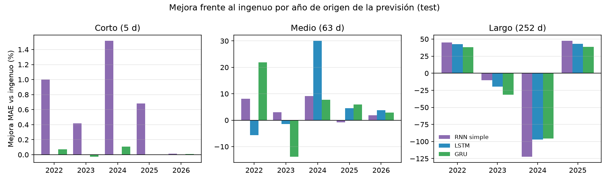

# Comparativa RNN simple vs LSTM vs GRU (y modelo ingenuo)

> Documento generado automáticamente por `oilcast report` a partir de `reports/results/`.
> Todas las cifras son **fuera de muestra** sobre el periodo de test (orígenes desde
> 2022-01-01) y se calculan en **dólares por barril**, sobre exactamente los mismos
> orígenes para las tres redes y para el modelo ingenuo.

## Condiciones de la comparación

- **Mismos datos y misma ventana**: las tres redes reciben las mismas
  60 sesiones de entrada en cada plazo.
  A 5 y 63 sesiones, 20 variables estacionarias (rentabilidades, diferenciales, volatilidad, desviaciones a medias móviles).
  A 252 sesiones, solo `oro_crudo`: barriles por onza de oro (log) frente a su media de 3 años, con un atajo lineal desde el último día (docs/experimento-ronda4.md).
- **Misma partición**: CV walk-forward expansiva y purgada en desarrollo (4 bloques de
  validación de 2 años: 2014-15, 2016-17, 2018-19, 2020-21) y test walk-forward desde
  2022-01-01 con reentreno cada 1 de enero, con los hiperparámetros y el nº de épocas
  fijados en la CV (el test nunca se usa para parar el entrenamiento).
- **Mismo presupuesto de ajuste**: 80 trials de Optuna (TPE, misma
  semilla, mismo espacio de búsqueda) por red y horizonte.
- **Salida probabilística**: cuantiles (pérdida pinball); valor central = mediana;
  intervalo del 80 % = cuantiles 10-90 calibrados con conformal (CQR) usando solo errores
  ya realizados antes de cada previsión.
- **5 semillas** por red: se informa el ensemble (media de
  las semillas) y la dispersión entre semillas (estabilidad).
- Modelo ingenuo: precio futuro = precio de hoy; su intervalo usa los cuantiles empíricos de
  las variaciones a h días del periodo de entrenamiento.
- **Sin deriva**: las redes aprenden desviaciones respecto a la media del entrenamiento y no se les devuelve esa media, para que no proyecten al futuro la tendencia del periodo de entrenamiento.
- **Recalibración del centro**: el valor central se encoge hacia el del ingenuo con un factor entre 0 y 1 estimado solo con los errores ya conocidos en cada fecha.

## Tabla comparativa (test)

| Horizonte | Modelo | MAE ($) | RMSE ($) | R² | Mejora MAE vs ingenuo | Mejora RMSE vs ingenuo | p-valor DM | Acierto direccional | Cobertura IC80 | Anchura IC80 ($) | Winkler IC80 | Parámetros | Tiempo entren. (s) |
|---|---|---|---|---|---|---|---|---|---|---|---|---|---|
| Corto (5 d) | Ingenuo | 3.99 | 5.74 | 0.875 | — | — | — | — | 76.1 % | 10.61 | 19.93 | — | — |
| Corto (5 d) | RNN simple | 3.96 | 5.71 | 0.876 | +0.6 % | +0.5 % | 0.148 | 53.3 % | 78.1 % | 10.80 | 19.09 | 5959 | 0.8 |
| Corto (5 d) | LSTM | 3.99 | 5.74 | 0.875 | +0.0 % | +0.0 % | — | — | 74.7 % | 10.54 | 19.00 | 1339143 | 0.6 |
| Corto (5 d) | GRU | 3.99 | 5.74 | 0.875 | +0.0 % | +0.0 % | 0.445 | 50.7 % | 78.8 % | 11.41 | 19.16 | 1004807 | 0.4 |
| Medio (63 d) | Ingenuo | 11.94 | 17.44 | -0.207 | — | — | — | — | 84.5 % | 38.45 | 65.21 | — | — |
| Medio (63 d) | RNN simple | 11.50 | 17.13 | -0.165 | +3.7 % | +1.7 % | 0.105 | 59.2 % | 87.6 % | 49.05 | 75.11 | 22599 | 0.2 |
| Medio (63 d) | LSTM | 11.57 | 17.33 | -0.192 | +3.2 % | +0.6 % | 0.855 | 60.0 % | 84.2 % | 44.11 | 72.06 | 89031 | 0.2 |
| Medio (63 d) | GRU | 11.26 | 16.98 | -0.143 | +5.7 % | +2.6 % | 0.427 | 65.3 % | 87.8 % | 47.99 | 74.32 | 11751 | 3.2 |
| Largo (252 d) | Ingenuo | 16.50 | 22.53 | -1.466 | — | — | — | — | 93.4 % | 90.15 | 97.57 | — | — |
| Largo (252 d) | RNN simple | 15.00 | 17.84 | -0.548 | +9.1 % | +20.8 % | 0.413 | 57.0 % | 99.6 % | 88.38 | 88.55 | 68117 | 0.3 |
| Largo (252 d) | LSTM | 14.85 | 17.86 | -0.550 | +10.0 % | +20.7 % | 0.396 | 53.6 % | 99.6 % | 89.95 | 90.17 | 84181 | 1.1 |
| Largo (252 d) | GRU | 15.55 | 19.29 | -0.809 | +5.7 % | +14.4 % | 0.526 | 61.1 % | 98.9 % | 90.49 | 91.38 | 990229 | 1.1 |

El R² compara el error cuadrático con el que se obtiene usando la media de los precios reales
del tramo evaluado. Puede ser negativo. El modelo ingenuo usa el último precio conocido.

*Mejora* = reducción porcentual del error frente al ingenuo (positivo = mejor que el
ingenuo). *p-valor DM*: test de Diebold-Mariano (error cuadrático, varianza HAC con h-1
retardos); valores < 0,05 indican diferencia significativa. Con h = 252 el test solo cubre
unos pocos años no solapados, por lo que su p-valor es orientativo. Tiempo de entrenamiento:
un ajuste completo (épocas fijas) sobre todo el periodo de desarrollo, medido en secuencia
en GPU.

## Estabilidad entre semillas

| Horizonte | Modelo | MAE ensemble | MAE por semilla (media ± desv.) | Mejora MAE por semilla (desv.) | Cobertura IC80 sin calibrar | MSE |
|---|---|---|---|---|---|---|
| Corto (5 d) | RNN simple | 3.96 | 3.94 ± 0.01 | 0.3 % | 73.4 % | 32.6 |
| Corto (5 d) | LSTM | 3.99 | 3.99 ± 0.01 | 0.3 % | 73.8 % | 32.9 |
| Corto (5 d) | GRU | 3.99 | 3.99 ± 0.02 | 0.5 % | 77.2 % | 32.9 |
| Medio (63 d) | RNN simple | 11.50 | 11.52 ± 0.35 | 2.9 % | 77.9 % | 293.6 |
| Medio (63 d) | LSTM | 11.57 | 13.63 ± 0.97 | 8.1 % | 71.0 % | 300.3 |
| Medio (63 d) | GRU | 11.26 | 14.10 ± 0.72 | 6.0 % | 71.6 % | 288.2 |
| Largo (252 d) | RNN simple | 15.00 | 15.19 ± 0.75 | 4.5 % | 98.0 % | 318.4 |
| Largo (252 d) | LSTM | 14.85 | 15.19 ± 1.12 | 6.8 % | 96.6 % | 319.0 |
| Largo (252 d) | GRU | 15.55 | 15.92 ± 1.52 | 9.2 % | 94.0 % | 372.3 |

## Resultados por año (mejora del MAE frente al ingenuo)

| Horizonte | Modelo | 2022 | 2023 | 2024 | 2025 | 2026 |
|---|---|---|---|---|---|---|
| Corto (5 d) | RNN simple | +1.0 % | +0.4 % | +1.5 % | +0.7 % | +0.0 % |
| Corto (5 d) | LSTM | +0.0 % | +0.0 % | +0.0 % | +0.0 % | +0.0 % |
| Corto (5 d) | GRU | +0.1 % | -0.0 % | +0.1 % | -0.0 % | +0.0 % |
| Corto (5 d) | MAE ingenuo ($) | 5.35 | 3.00 | 2.36 | 2.39 | 7.45 |
| Medio (63 d) | RNN simple | +8.1 % | +3.0 % | +9.1 % | -0.9 % | +1.9 % |
| Medio (63 d) | LSTM | -5.7 % | -1.5 % | +30.0 % | +4.6 % | +3.7 % |
| Medio (63 d) | GRU | +21.9 % | -13.8 % | +7.8 % | +5.9 % | +2.9 % |
| Medio (63 d) | MAE ingenuo ($) | 12.94 | 8.62 | 4.82 | 9.07 | 32.75 |
| Largo (252 d) | RNN simple | +45.1 % | -10.5 % | -122.2 % | +47.4 % | — |
| Largo (252 d) | LSTM | +42.4 % | -19.7 % | -96.9 % | +42.9 % | — |
| Largo (252 d) | GRU | +38.1 % | -31.4 % | -95.9 % | +38.6 % | — |
| Largo (252 d) | MAE ingenuo ($) | 19.32 | 7.61 | 11.43 | 29.64 | — |

## Hiperparámetros elegidos en la CV

| Modelo | Horizonte | hidden | capas | dropout | lr | weight decay | batch | épocas (fijas) | trials (podados) |
|---|---|---|---|---|---|---|---|---|---|
| RNN simple | 5 | 64 | 1 | 0.50 | 6.2e-04 | 1.1e-05 | 128 | 25 | 80 (31) |
| RNN simple | 63 | 64 | 3 | 0.42 | 2.1e-03 | 4.6e-05 | 256 | 7 | 80 (30) |
| RNN simple | 252 | 256 | 1 | 0.38 | 1.7e-03 | 5.4e-04 | 128 | 9 | 80 (43) |
| LSTM | 5 | 256 | 3 | 0.09 | 8.9e-04 | 5.3e-04 | 128 | 3 | 80 (40) |
| LSTM | 63 | 64 | 3 | 0.32 | 2.1e-03 | 5.9e-05 | 256 | 4 | 80 (20) |
| LSTM | 252 | 64 | 3 | 0.11 | 2.6e-03 | 3.3e-03 | 128 | 22 | 80 (48) |
| GRU | 5 | 256 | 3 | 0.47 | 2.9e-03 | 9.7e-03 | 128 | 2 | 80 (35) |
| GRU | 63 | 32 | 2 | 0.46 | 1.1e-04 | 8.1e-06 | 64 | 37 | 80 (28) |
| GRU | 252 | 256 | 3 | 0.25 | 1.9e-03 | 7.6e-03 | 64 | 4 | 80 (47) |

## Elección del modelo para la aplicación

La aplicación usa la RNN simple en los tres plazos (propuesta B): 20 variables diarias a 1 semana y 3 meses, y la relación oro/crudo a 1 año. En el test es la mejor de las tres redes a 1 semana y en la media de los tres plazos, la que menos varía entre semillas y la que tiene menos parámetros. La combinación se eligió después de ver el test 2022-2026: antes de 2022 mejoraba al ingenuo un 3,7 % de media, frente al 5,3 % de la LSTM que había elegido la regla de la ronda 4. La ronda 5 probó variantes con una regla fijada antes de entrenar y ninguna superó a B en todos los periodos anteriores a 2022.

| Modelo | MAE relativo medio (modelo/ingenuo) | Desv. relativa entre semillas | Parámetros (media) | Cobertura IC80 media |
|---|---|---|---|---|
| RNN simple | 0.955 | 2.8 % | 32225 | 88.4 % |
| LSTM | 0.956 | 5.4 % | 504118 | 86.2 % |
| GRU | 0.962 | 5.6 % | 668929 | 88.5 % |

Tiempo total de entrenamiento de los tres horizontes: RNN simple 1 s, LSTM 2 s, GRU 5 s

**Modelo elegido: RNN simple.**

### Alternativas que ganan en el test

Mejora del MAE frente al ingenuo; entre paréntesis, la de B, la red de la aplicación.

| Plazo | Alternativa | Test 2022-2026 | 2008-2021 | Por qué no se usa |
|---|---|---|---|---|
| Corto (5 d) | GRU de la primera versión de la app | +1,6 % (B +0,6 %) | — | Es otra arquitectura y pierde en los otros plazos: −8,0 % a 3 meses y −15,1 % a 1 año. |
| Corto (5 d) | RNN con el movimiento de los futuros tras la valoración del spot (ronda 5) | +0,9 % (B +0,6 %) | −0,2 % (B −0,2 %) | Antes de 2022 empataba con B. En el test la diferencia es de 1,3 céntimos por barril. |
| Medio (63 d) | Media de RNN, LSTM y GRU (ronda 5) | +7,1 % (B +3,7 %) | −1,5 % (B −1,6 %) | Mezcla tres arquitecturas y antes de 2022 empataba con B. |
| Medio (63 d) | GRU con las mismas variables | +5,7 % (B +3,7 %) | −1,2 % (B −1,6 %) | Es otra arquitectura. A 1 semana no mejora al ingenuo y a 1 año gana menos (+5,8 % frente a +9,1 %). |
| Largo (252 d) | LSTM con la relación oro/crudo | +10,0 % (B +9,1 %) | +12,9 % (B +13,0 %) | Es otra arquitectura. A 1 semana no se aparta del ingenuo y a 3 meses gana menos (+3,2 % frente a +3,7 %). |
| Largo (252 d) | RNN con 20 semillas en lugar de 5 (ronda 5) | +11,1 % (B +9,1 %) | +14,7 % (B +13,0 %) | En 2008-2013 quedaba 0,3 puntos por debajo de B, y la regla fijada antes de entrenar exigía no empeorar en ningún periodo. Su intervalo en el test es igual de ancho. |

Ninguna gana a B a la vez en los tres plazos, en el test y en todos los periodos anteriores a 2022. Cambiar el modelo por una de ellas sería ajustarlo al periodo 2022-2026, que ya se usó para elegir B.

## Conclusión

**Modelo para la aplicación: RNN simple.**

- **Precisión**: su MAE medio es 0,955 veces el del ingenuo, el mejor de las tres redes; LSTM 0,956, GRU 0,962.
- **Estabilidad**: es la red más estable entre semillas (desviación relativa del MAE 2,8 %, LSTM 5,4 %, GRU 5,6 %), es decir, su resultado depende poco de la inicialización aleatoria.
- **Coste computacional**: entrenar los tres horizontes cuesta 1,4 s en GPU (LSTM 1,9 s, GRU 4,8 s); el coste no discrimina entre redes y el reentrenado periódico es viable en CPU.

**Dónde aporta valor y dónde no**

- **Corto (5 d)**: mejora marginal del valor central (+0,6 % de MAE y +0,5 % de RMSE; las tres redes entre +0,0 % y +0,6 % de MAE), positiva en 5 de 5 años, **no significativa** (p-valor DM 0,148). Acierta la dirección en el 53,3 % de los casos (apostar siempre por el movimiento más frecuente del periodo, algo que no se sabe de antemano, habría acertado el 50,7 %). El intervalo del 80 % calibrado cubre el 78,1 % de los casos (ingenuo: 76,1 %) y su puntuación de Winkler (anchura + penalización por fallos; menor es mejor) es 19,09 frente a 19,93 del ingenuo: el rango es algo más informativo que el del ingenuo.
- **Medio (63 d)**: mejora del valor central (+3,7 % de MAE y +1,7 % de RMSE; las tres redes entre +3,2 % y +5,7 % de MAE), positiva en 4 de 5 años, **no significativa** (p-valor DM 0,105). Acierta la dirección en el 59,2 % de los casos (apostar siempre por el movimiento más frecuente del periodo, algo que no se sabe de antemano, habría acertado el 56,8 %). El intervalo del 80 % calibrado cubre el 87,6 % de los casos (ingenuo: 84,5 %) y su puntuación de Winkler (anchura + penalización por fallos; menor es mejor) es 75,11 frente a 65,21 del ingenuo: el rango no es mejor que el del ingenuo.
- **Largo (252 d)**: mejora del valor central (+9,1 % de MAE y +20,8 % de RMSE; las tres redes entre +5,7 % y +10,0 % de MAE), positiva en 2 de 4 años, **no significativa** (p-valor DM 0,413). Acierta la dirección en el 57,0 % de los casos (apostar siempre por el movimiento más frecuente del periodo, algo que no se sabe de antemano, habría acertado el 67,7 %). El intervalo del 80 % calibrado cubre el 99,6 % de los casos (ingenuo: 93,4 %) y su puntuación de Winkler (anchura + penalización por fallos; menor es mejor) es 88,55 frente a 97,57 del ingenuo: el rango es algo más informativo que el del ingenuo.

**Interpretación.** A partir solo de precios y variables de mercado pasadas, el precio del crudo se comporta casi como un paseo aleatorio, y el periodo de test incluye dos shocks geopolíticos (Ucrania 2022 y la guerra con Irán en 2026) que ningún modelo de este tipo puede anticipar. El modelo elegido mejora al ingenuo en el valor central a corto (5 d), medio (63 d) y largo (252 d), sin que ninguna diferencia sea estadísticamente significativa. Por eso la aplicación muestra siempre el intervalo, indica en cada horizonte si el modelo mejoró o no al «precio no cambia» en el test y presenta la cifra central como referencia donde no lo mejora.
