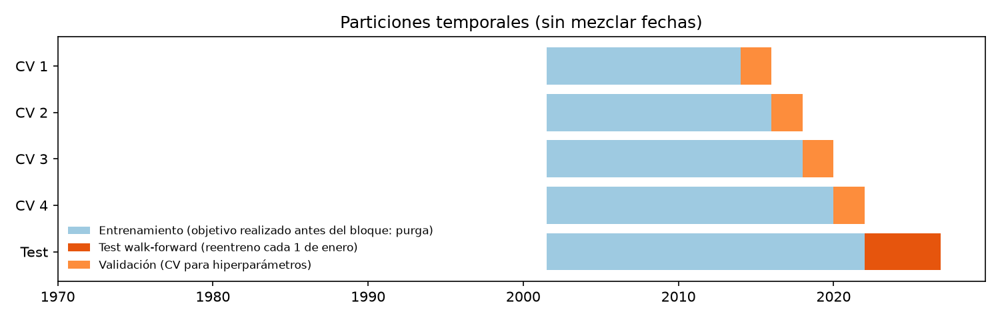

# Comparativa RNN simple vs LSTM vs GRU (y modelo ingenuo)

> Documento generado automáticamente por `oilcast report` a partir de `reports/results/`.
> Todas las cifras son **fuera de muestra** sobre el periodo de test (orígenes desde
> 2022-01-01) y se calculan en **dólares por barril**, sobre exactamente los mismos
> orígenes para las tres redes y para el modelo ingenuo.

## Condiciones de la comparación

- **Mismos datos y misma ventana**: 60 días hábiles de 20
  variables estacionarias (rentabilidades, diferenciales, volatilidad, desviaciones a medias
  móviles).
- **Misma partición**: CV walk-forward expansiva y purgada en desarrollo (4 bloques de
  validación de 2 años: 2014-15, 2016-17, 2018-19, 2020-21) y test walk-forward desde
  2022-01-01 con reentreno cada 1 de enero, con los hiperparámetros y el nº de épocas
  fijados en la CV (el test nunca se usa para parar el entrenamiento).
- **Mismo presupuesto de ajuste**: 80 trials de Optuna (TPE, misma
  semilla, mismo espacio de búsqueda) por red y horizonte.
- **Salida probabilística**: cuantiles (pérdida pinball); valor central = mediana;
  intervalo del 80 % = cuantiles 10-90 calibrados con conformal (CQR) usando solo errores
  ya realizados antes de cada previsión.
- **5 semillas** por red: se informa el ensemble (media de
  las semillas) y la dispersión entre semillas (estabilidad).
- Modelo ingenuo: precio futuro = precio de hoy; su intervalo usa los cuantiles empíricos de
  las variaciones a h días del periodo de entrenamiento.
- **Sin deriva**: las redes aprenden desviaciones respecto a la media del entrenamiento y no se les devuelve esa media, para que no proyecten al futuro la tendencia del periodo de entrenamiento.
- **Recalibración del centro**: el valor central se encoge hacia el del ingenuo con un factor entre 0 y 1 estimado solo con los errores ya conocidos en cada fecha.

## Tabla comparativa (test)

| Horizonte | Modelo | MAE ($) | RMSE ($) | R² | Mejora MAE vs ingenuo | Mejora RMSE vs ingenuo | p-valor DM | Acierto direccional | Cobertura IC80 | Anchura IC80 ($) | Winkler IC80 | Parámetros | Tiempo entren. (s) |
|---|---|---|---|---|---|---|---|---|---|---|---|---|---|
| Corto (5 d) | Ingenuo | 3.99 | 5.74 | 0.875 | — | — | — | — | 76.1 % | 10.61 | 19.93 | — | — |
| Corto (5 d) | RNN simple | 3.95 | 5.70 | 0.876 | +0.9 % | +0.6 % | 0.224 | 53.3 % | 79.0 % | 11.04 | 19.03 | 5959 | 0.9 |
| Corto (5 d) | LSTM | 3.99 | 5.74 | 0.875 | +0.0 % | +0.0 % | — | — | 75.9 % | 10.83 | 18.91 | 1339143 | 0.6 |
| Corto (5 d) | GRU | 3.98 | 5.73 | 0.875 | +0.1 % | +0.1 % | 0.372 | 50.7 % | 81.1 % | 11.98 | 19.12 | 1004807 | 0.4 |
| Medio (63 d) | Ingenuo | 11.94 | 17.44 | -0.207 | — | — | — | — | 84.5 % | 38.45 | 65.21 | — | — |
| Medio (63 d) | RNN simple | 11.47 | 17.12 | -0.163 | +4.0 % | +1.8 % | 0.118 | 59.2 % | 87.7 % | 49.66 | 75.72 | 22599 | 0.2 |
| Medio (63 d) | LSTM | 11.55 | 17.32 | -0.191 | +3.3 % | +0.7 % | 0.839 | 60.0 % | 85.7 % | 45.53 | 72.82 | 89031 | 0.2 |
| Medio (63 d) | GRU | 11.30 | 17.01 | -0.148 | +5.4 % | +2.4 % | 0.487 | 65.3 % | 88.2 % | 48.62 | 75.32 | 11751 | 3.2 |
| Largo (252 d) | Ingenuo | 16.50 | 22.53 | -1.466 | — | — | — | — | 93.3 % | 89.74 | 97.12 | — | — |
| Largo (252 d) | RNN simple | 17.63 | 27.06 | -2.559 | -6.8 % | -20.1 % | 0.120 | 54.3 % | 89.7 % | 113.94 | 128.91 | 204551 | 0.7 |
| Largo (252 d) | LSTM | 20.24 | 27.52 | -2.682 | -22.7 % | -22.2 % | 0.033 | 52.6 % | 88.7 % | 104.82 | 125.67 | 89031 | 0.1 |
| Largo (252 d) | GRU | 16.61 | 24.73 | -1.972 | -0.7 % | -9.8 % | 0.198 | 54.8 % | 95.3 % | 133.76 | 137.71 | 66887 | 0.1 |

El R² compara el error cuadrático con el que se obtiene usando la media de los precios reales
del tramo evaluado. Puede ser negativo. El modelo ingenuo usa el último precio conocido.

*Mejora* = reducción porcentual del error frente al ingenuo (positivo = mejor que el
ingenuo). *p-valor DM*: test de Diebold-Mariano (error cuadrático, varianza HAC con h-1
retardos); valores < 0,05 indican diferencia significativa. Con h = 252 el test solo cubre
unos pocos años no solapados, por lo que su p-valor es orientativo. Tiempo de entrenamiento:
un ajuste completo (épocas fijas) sobre todo el periodo de desarrollo, medido en secuencia
en GPU.

## Estabilidad entre semillas

| Horizonte | Modelo | MAE ensemble | MAE por semilla (media ± desv.) | Mejora MAE por semilla (desv.) | Cobertura IC80 sin calibrar | MSE |
|---|---|---|---|---|---|---|
| Corto (5 d) | RNN simple | 3.95 | 3.94 ± 0.01 | 0.3 % | 73.8 % | 32.5 |
| Corto (5 d) | LSTM | 3.99 | 3.99 ± 0.01 | 0.3 % | 73.8 % | 32.9 |
| Corto (5 d) | GRU | 3.98 | 3.99 ± 0.02 | 0.5 % | 77.4 % | 32.9 |
| Medio (63 d) | RNN simple | 11.47 | 11.52 ± 0.35 | 2.9 % | 77.5 % | 293.0 |
| Medio (63 d) | LSTM | 11.55 | 13.63 ± 0.97 | 8.1 % | 71.3 % | 300.0 |
| Medio (63 d) | GRU | 11.30 | 14.10 ± 0.72 | 6.0 % | 71.0 % | 289.4 |
| Largo (252 d) | RNN simple | 17.63 | 19.80 ± 3.44 | 20.8 % | 77.9 % | 732.3 |
| Largo (252 d) | LSTM | 20.24 | 22.59 ± 1.66 | 10.0 % | 69.4 % | 757.5 |
| Largo (252 d) | GRU | 16.61 | 22.52 ± 1.40 | 8.5 % | 76.6 % | 611.4 |

## Resultados por año (mejora del MAE frente al ingenuo)

| Horizonte | Modelo | 2022 | 2023 | 2024 | 2025 | 2026 |
|---|---|---|---|---|---|---|
| Corto (5 d) | RNN simple | +1.6 % | +0.6 % | +2.0 % | +1.1 % | -0.1 % |
| Corto (5 d) | LSTM | +0.0 % | +0.0 % | +0.0 % | +0.0 % | +0.0 % |
| Corto (5 d) | GRU | +0.2 % | -0.1 % | +0.3 % | -0.0 % | +0.0 % |
| Corto (5 d) | MAE ingenuo ($) | 5.35 | 3.00 | 2.36 | 2.39 | 7.45 |
| Medio (63 d) | RNN simple | +8.8 % | +3.2 % | +9.7 % | -1.1 % | +2.1 % |
| Medio (63 d) | LSTM | -5.4 % | -1.1 % | +30.1 % | +4.7 % | +3.6 % |
| Medio (63 d) | GRU | +23.4 % | -16.6 % | +5.3 % | +5.8 % | +2.9 % |
| Medio (63 d) | MAE ingenuo ($) | 12.94 | 8.62 | 4.82 | 9.07 | 32.75 |
| Largo (252 d) | RNN simple | -26.9 % | -4.1 % | +64.1 % | -24.7 % | — |
| Largo (252 d) | LSTM | -18.8 % | -141.3 % | +62.8 % | -29.0 % | — |
| Largo (252 d) | GRU | -11.1 % | -15.6 % | +51.6 % | -12.1 % | — |
| Largo (252 d) | MAE ingenuo ($) | 19.32 | 7.61 | 11.43 | 29.64 | — |

## Hiperparámetros elegidos en la CV

| Modelo | Horizonte | hidden | capas | dropout | lr | weight decay | batch | épocas (fijas) | trials (podados) |
|---|---|---|---|---|---|---|---|---|---|
| RNN simple | 5 | 64 | 1 | 0.50 | 6.2e-04 | 1.1e-05 | 128 | 25 | 80 (31) |
| RNN simple | 63 | 64 | 3 | 0.42 | 2.1e-03 | 4.6e-05 | 256 | 7 | 80 (30) |
| RNN simple | 252 | 256 | 2 | 0.47 | 2.5e-03 | 1.0e-02 | 128 | 10 | 80 (27) |
| LSTM | 5 | 256 | 3 | 0.09 | 8.9e-04 | 5.3e-04 | 128 | 3 | 80 (40) |
| LSTM | 63 | 64 | 3 | 0.32 | 2.1e-03 | 5.9e-05 | 256 | 4 | 80 (20) |
| LSTM | 252 | 64 | 3 | 0.33 | 1.4e-03 | 1.4e-04 | 128 | 2 | 80 (38) |
| GRU | 5 | 256 | 3 | 0.47 | 2.9e-03 | 9.7e-03 | 128 | 2 | 80 (35) |
| GRU | 63 | 32 | 2 | 0.46 | 1.1e-04 | 8.1e-06 | 64 | 37 | 80 (28) |
| GRU | 252 | 64 | 3 | 0.47 | 1.7e-03 | 5.9e-05 | 256 | 2 | 80 (28) |

## Elección del modelo para la aplicación

Regla aplicada: regla fijada antes de ejecutar la ronda 2 (docs/experimento-ronda2.md): se elige la combinación de configuración y red con mayor mejora media del MAE frente al ingenuo en las predicciones anteriores a 2022 (reentrenos de 2014 a 2020), sin mirar el test. Ganó la RNN simple entrenada sin deriva y con recalibración del centro (+3,8 % antes de 2022).

| Modelo | MAE relativo medio (modelo/ingenuo) | Desv. relativa entre semillas | Parámetros (media) | Cobertura IC80 media |
|---|---|---|---|---|
| GRU | 0.984 | 5.1 % | 361148 | 88.2 % |
| RNN simple | 1.007 | 7.6 % | 77703 | 85.5 % |
| LSTM | 1.065 | 5.6 % | 505735 | 83.4 % |

Tiempo total de entrenamiento de los tres horizontes: RNN simple 2 s, LSTM 1 s, GRU 4 s

**Modelo elegido: RNN simple.**

## Conclusión

**Modelo para la aplicación: RNN simple.**

- **Precisión**: su MAE medio es 1,007 veces el del ingenuo; en test la mejor fue GRU (0,984), pero la elección se fijó antes de ver el test, con las predicciones anteriores a 2022 (ver la regla); LSTM 1,065.
- **Estabilidad**: desviación relativa del MAE entre semillas 7,6 %.
- **Coste computacional**: entrenar los tres horizontes cuesta 1,8 s en GPU (GRU 3,7 s, LSTM 0,9 s); el coste no discrimina entre redes y el reentrenado periódico es viable en CPU.

**Dónde aporta valor y dónde no**

- **Corto (5 d)**: mejora marginal del valor central (+0,9 % de MAE; las tres redes entre +0,0 % y +0,9 %), positiva en 4 de 5 años, **no significativa** (p-valor DM 0,224). Acierta la dirección en el 53,3 % de los casos (apostar siempre por el movimiento más frecuente del periodo, algo que no se sabe de antemano, habría acertado el 50,7 %). El intervalo del 80 % calibrado cubre el 79,0 % de los casos (ingenuo: 76,1 %) y su puntuación de Winkler (anchura + penalización por fallos; menor es mejor) es 19,03 frente a 19,93 del ingenuo: el rango es algo más informativo que el del ingenuo.
- **Medio (63 d)**: mejora marginal del valor central (+4,0 % de MAE; las tres redes entre +3,3 % y +5,4 %), positiva en 4 de 5 años, **no significativa** (p-valor DM 0,118). Acierta la dirección en el 59,2 % de los casos (apostar siempre por el movimiento más frecuente del periodo, algo que no se sabe de antemano, habría acertado el 56,8 %). El intervalo del 80 % calibrado cubre el 87,7 % de los casos (ingenuo: 84,5 %) y su puntuación de Winkler (anchura + penalización por fallos; menor es mejor) es 75,72 frente a 65,21 del ingenuo: el rango no es mejor que el del ingenuo.
- **Largo (252 d)**: **no aporta valor en el valor central**: el error es mayor que el del ingenuo (-6,8 % de MAE, p-valor DM 0,120; las tres redes entre -22,7 % y -0,7 %); solo mejora en 1 de 4 años. Acierta la dirección en el 54,3 % de los casos (apostar siempre por el movimiento más frecuente del periodo, algo que no se sabe de antemano, habría acertado el 67,7 %). El intervalo del 80 % calibrado cubre el 89,7 % de los casos (ingenuo: 93,3 %) y su puntuación de Winkler (anchura + penalización por fallos; menor es mejor) es 128,91 frente a 97,12 del ingenuo: el rango no es mejor que el del ingenuo.

**Interpretación.** A partir solo de precios y variables de mercado pasadas, el precio del crudo se comporta casi como un paseo aleatorio, y el periodo de test incluye dos shocks geopolíticos (Ucrania 2022 y la guerra con Irán en 2026) que ningún modelo de este tipo puede anticipar. El modelo elegido mejora al ingenuo en el valor central a corto (5 d) y medio (63 d) y no a largo (252 d), sin que ninguna diferencia sea estadísticamente significativa. Por eso la aplicación muestra siempre el intervalo, indica en cada horizonte si el modelo mejoró o no al «precio no cambia» en el test y presenta la cifra central como referencia donde no lo mejora.
